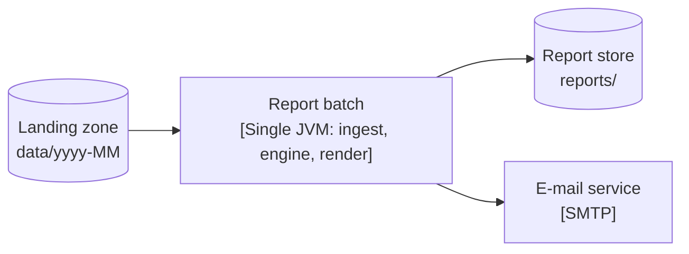
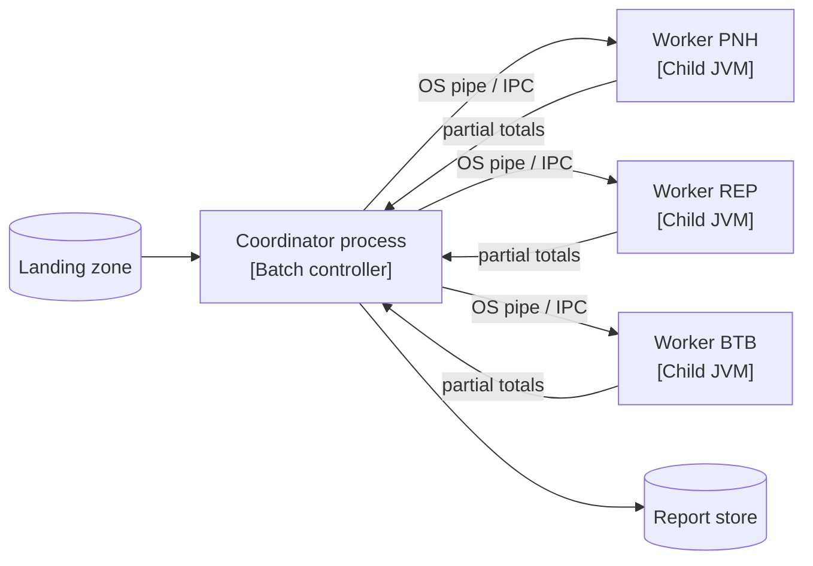
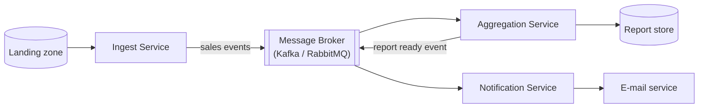

# ATAM-style evaluation: release 1 architecture

## Business drivers

- **Timely morning delivery**: The consolidated monthly sales report for month M must be available on the morning of day 2 of month M+1 by 07:00 (brief).
- **Retail scale and expansion**: Support 3 retail branches (PNH, REP, BTB) processing ~33,000 transactions/day (~3 million rows/month), with seamless configuration-only onboarding of future branches (QA-2).
- **Fault-tolerant branch links**: WAN connections between branches and head office fail intermittently; the system must gracefully handle missing files, emit partial reports, and incorporate late files without duplicates (QA-3).
- **Resource and team constraints**: Built and maintained by a 2-person engineering team within semester deadlines, requiring minimal operational infrastructure overhead.
- **Confidentiality and role segregation**: Strict isolation ensuring branch managers can only inspect their own branch figures, while head-office analysts have chain-wide visibility (QA-5).

---

## Candidates

### Candidate A: Modular monolith batch (one JVM)
All components (`ingest`, `engine`, `render`, `ui`) run within a single Java 25 virtual machine. Processing is triggered by an OS scheduler, reading daily files from a local landing zone, computing aggregates in parallel across local threads, and writing to local storage.

### Candidate B: Process pipeline (coordinator and child worker processes)
A central coordinator process manages the workflow and spawns dedicated worker processes (one per branch or daily partition) communicating over anonymous OS pipes or local domain sockets. Workers return partial aggregates which the coordinator merges.

### Candidate C: Event-driven microservices (message broker)
Independent microservices (`IngestService`, `AggregationService`, `ReportService`, `NotificationService`) run as separate network services decoupled by a central message broker (e.g., Apache Kafka or RabbitMQ).

---

## Scenario analysis

| Scenario | Candidate A: Modular Monolith | Candidate B: Process Pipeline | Candidate C: Microservices |
|---|---|---|---|
| **QA-1: Performance** (3 M rows in $\le 60\text{ s}$) | **++** In-memory thread pools and zero serialization overhead complete the batch run in ~4.9 s. | **+** Parallel worker processes achieve ~8.6 s, slightly slowed by process startup and IPC serialization. | **−** Broker hop and message serialization take >60 s unless aggressive event batching is implemented. |
| **QA-2: Scalability** (4th branch adds $\le 35\%$ run time) | **+** Extra branch files simply add parallel tasks to local worker threads on the 8-core server. | **++** New branch spawns an isolated worker process without altering the coordinator codebase. | **++** Granular horizontal scaling allows deploying additional ingest and aggregator containers. |
| **QA-3: Availability** (Missing file, partial report by 07:00) | **+** Single scheduler checks file inventory at 06:30 and triggers partial report generation locally. | **+** Coordinator skips missing branch worker, produces partial report, and triggers worker on late file. | **++** Broker topic natively queues and buffers late branch sales without coordination logic. |
| **QA-4: Modifiability** (New export format in $\le 2\text{ days}$) | **++** Sealed Strategy pattern (`ReportRenderer`) localizes format additions to a single new class. | **+** Renderers run inside coordinator; adding a format is localized but requires pipeline rebuild. | **0** Adding format requires creating, deploying, and maintaining a new standalone microservice. |
| **QA-5: Security** (Manager sees own branch only) | **+** In-process domain model partitions summary data; web layer applies role-based filters on disk files. | **+** Process boundary cleanly separates branch data; coordinator enforces branch view privileges. | **++** Branch endpoints and microservice ACLs provide strict physical network and identity isolation. |
| **QA-6: Testability** (mvn test in $\le 30\text{ s}$) | **++** Plain JUnit 6 tests execute in ~3 s using local fixtures without mocks, sockets, or daemon containers. | **0** Testing requires IPC harnesses, process lifecycle mocking, and OS-dependent pipe management. | **−−** Testing requires running Docker containers, embedded brokers, and asynchronous event assertions. |
| **Cost & Skills** (2-person team, semester deadline) | **++** Zero infrastructure cost; standard Java 25 / Maven build running on any single developer laptop or VM. | **0** Moderate complexity in multi-process supervision, exit code monitoring, and cross-platform IPC. | **−−** High infrastructure cost and cognitive load operating container clusters, brokers, and schema registries. |

---

## QA-1 quantitative estimates (assumptions first)

### Benchmark and workload assumptions
1. **Dataset**: 3 branches $\times$ 30 days $\times$ 33,000 rows = $3,000,000$ CSV lines.
2. **Hardware**: 8-core CPU ($p = 8$), SSD storage, 16 GB RAM.
3. **Per-row parsing**: CsvTransactionParser takes $5\,\mu\text{s}$ per row on a single core ($3.0\text{ M} \times 5\,\mu\text{s} = 15.0\text{ s}$ total CPU parse time).
4. **Serial bottlenecks**:
   - Accumulator merge across branches: $T_{\text{merge}} = 2.0\text{ s}$.
   - Report formatting and file writing (Text, HTML, CSV): $T_{\text{render}} = 1.0\text{ s}$.
   - Total serial time $T_{\text{serial}} = 2.0 + 1.0 = 3.0\text{ s}$.
5. **Parallelizable fraction ($f$)**:
   $$f = \frac{T_{\text{parallel}}}{T_{\text{parallel}} + T_{\text{serial}}} = \frac{15.0}{15.0 + 3.0} = 83.33\%$$
   By Amdahl's Law, maximum theoretical speedup on $p = 8$ cores is:
   $$S(8) = \frac{1}{(1 - f) + \frac{f}{p}} = \frac{1}{(1 - 0.8333) + \frac{0.8333}{8}} = \frac{1}{0.1667 + 0.1042} = \frac{1}{0.2709} \approx 3.69\times$$

### Estimates per candidate

- **Candidate A (Modular Monolith, 8 in-memory threads)**:
  $$T_A = T_{\text{serial}} + \frac{T_{\text{parallel}}}{p} = 3.0\text{ s} + \frac{15.0\text{ s}}{8} = 3.0 + 1.875 = 4.88\text{ s} \approx 4.9\text{ s}$$
  Zero serialization overhead. **Result: 4.9 s $\ll$ 60 s (Meets QA-1 with 12x headroom).**

- **Candidate B (Process Pipeline, 3 branch worker JVMs)**:
  Each branch worker parses $1.0\text{ M}$ rows ($5.0\text{ s}$ CPU work). With 3 branch processes running concurrently on 8 cores:
  Parallel compute time $= 5.0\text{ s}$.
  Parallel JVM process startup overhead: $+0.5\text{ s}$.
  IPC serialization of partial summaries (few KB of data): $+0.05\text{ s}$.
  Coordinator serial merge and render: $+3.0\text{ s}$.
  $$T_B = 0.5 + 5.0 + 0.05 + 3.0 = 8.55\text{ s} \approx 8.6\text{ s}$$
  **Result: 8.6 s $\ll$ 60 s (Meets QA-1).**

- **Candidate C (Event-Driven Microservices, message broker)**:
  Assume a high-performance message broker processing $50,000\text{ msg/s}$.
  - *Sub-case 1 (Naive 1 row per event)*:
    Broker transfer alone for $3.0\text{ M}$ messages:
    $$\frac{3,000,000\text{ msgs}}{50,000\text{ msg/s}} = 60.0\text{ s}$$
    Adding network serialization, ingest parsing, and rendering ($+8.0\text{ s}$) yields $T_C \approx 68.0\text{ s}$. **Result: Fails QA-1 (> 60 s).**
  - *Sub-case 2 (Micro-batched events, 1,000 rows/event)*:
    Total messages $= 3,000$. Broker transfer time $= 3,000 / 50,000 = 0.06\text{ s}$. Total pipeline time $\approx 7.1\text{ s}$. **Result: Meets QA-1, but strictly dependent on batching.**

---

## Sensitivity points

- **S1: Core count ($p$)**: Affects **QA-1 (Performance)** directly in Candidates A and B. Increasing cores from 4 to 8 reduces Candidate A parallel parsing time from $3.75\text{ s}$ to $1.88\text{ s}$, but beyond 8 cores Amdahl's Law limits overall speedup due to the $3.0\text{ s}$ serial merge/render fraction.
- **S2: Event batch size ($B$)**: Affects **QA-1 (Performance)** in Candidate C by three orders of magnitude (from $68\text{ s}$ down to $7.1\text{ s}$). If batch size drops below 200 rows/msg, Candidate C breaches the 60-second limit.
- **S3: Number of retail branches ($N_{\text{branch}}$)**: Affects **QA-2 (Scalability)** and **QA-3 (Availability)** in Candidate B. Adding branches increases the number of concurrent child processes, raising OS process management overhead and IPC descriptor limits.

---

## Trade-off points

- **T1: Asynchronous broker decoupling (Candidate C)**:
  - *Gain (+QA-3)*: Buffers branch feeds asynchronously during network link outages and isolates ingest from reporting.
  - *Loss (−QA-1, −Cost, −QA-5)*: Introduces network serialization latency, requires dedicated broker infrastructure management, and widens network attack surface.
- **T2: Process isolation boundary (Candidate B vs. Candidate A)**:
  - *Gain (+Fault isolation)*: A memory corrupt or crash in one branch parser does not crash the coordinator process.
  - *Loss (−QA-1, −QA-6, −Simplicity)*: Introduces process startup lag ($+0.5\text{ s}$), requires IPC serialization protocols, and makes automated testing significantly more complex.

---

## Risks, non-risks, risk themes

### Risk Theme 1: Engineering Velocity & Project Delivery
*Linked to Business Driver: 2-person development team working within semester deadlines.*
- **Risk R1 (Candidate C)**: Implementing event-driven microservices introduces distributed system failure modes (split-brain, out-of-order events, network partitions, schema upgrades) that exceed the 2-person team's maintenance capacity and jeopardize semester delivery.
- **Non-risk NR1 (Candidate A)**: While monoliths can suffer from tight coupling, enforcing package boundaries through automated architectural unit tests (`DependencyRulesTest`) guarantees architectural integrity with zero runtime deployment risk.

### Risk Theme 2: Report Timeliness & Batch Robustness
*Linked to Business Driver: Day 2 07:00 morning deadline under unreliable branch WAN links.*
- **Risk R2 (Candidate A)**: A fatal JVM error or unhandled OutOfMemoryError in a single branch parser terminates the entire monthly batch run, delaying report delivery past the 07:00 deadline.
- **Non-risk NR2 (Candidate A)**: Parsing $3.0\text{ M}$ rows with streaming accumulators consumes under $256\text{ MB}$ of JVM heap. With modern garbage collectors (ZGC/G1 in Java 25), out-of-memory risks on an 8-core server are negligible.

---

## Recommendation

**We unequivocally confirm ADR-0001 (Modular Monolith Batch for Release 1).**

Candidate A decisively fulfills all business and technical drivers:
1. It achieves an estimated run time of **$4.9\text{ s}$** on 8 cores, outperforming the $60\text{ s}$ QA-1 threshold by a factor of 12.
2. It delivers the highest developer testability (**QA-6**), executing the entire test suite in under $3\text{ s}$ without external dependencies.
3. It completely avoids the operational complexity, distributed failure modes, and message overhead of Candidate C, while eliminating the cross-platform IPC maintenance of Candidate B.

**Revisit Trigger**: Revisit this architecture (drafting ADR-0003) if monthly volume exceeds 10 million transactions, or if business requirements pivot to continuous real-time intraday reporting.
